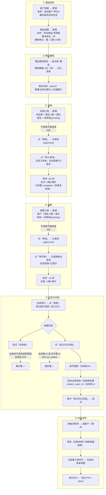

# 全链路业务验收：流程图 + 操作向导（v182）

> 适用版本：v182 · 20261022-1507
> 场景：测试客户「测试客户-甲001」+ 测试商品「测试商品-劳保鞋（1箱=10双）」，从期初建账走到对账单导出。
> 文中所有"业务规则"都对应当前代码里的真实校验，不是理想流程。

---

## 一、Mermaid 流程图



---

## 二、《测试操作向导》

### ① 基础资料

| 步 | 入口菜单 | 操作 | 预期结果 | 业务规则（代码里真实存在） |
|---|---|---|---|---|
| 1 | 基础资料 → **客户档案** | 新增；名称 `测试客户-甲001`，编码留空 | 列表出现新客户，编码形如 `甲CUSxxxx` | 编码可留空自动生成；**建议名称带「测试客户」前缀**（后面清理要用，见第三节） |
| 2 | 基础资料 → **商品档案** | 新增；名称 `测试商品-劳保鞋`，基本单位 `双`；在「辅助单位与换算」里加 `箱 = 10` | 商品行出现；单位显示 `双` | 辅助单位存 `product_units` 表；**换算系数由服务端解析，前端传"用哪个单位"而不是系数** |

> 命名建议：`测试商品-…` / `测试客户-…` 是 `clean_test_data.py` 的黑名单前缀，能一键清干净。

### ② 期初建账

| 步 | 入口菜单 | 操作 | 预期结果 | 业务规则 |
|---|---|---|---|---|
| 3 | 基础资料 → **商品期初库存** → 库存期初 | 选仓库 + 商品，数量 `100`，单价按成本，点「加入清单」→「保存全部」 | 「已建账期初」出现 1 行；现存量 +100 双 | 幂等 upsert，按「仓库×商品」去重；**数量与单价都为 0 会被删除**；期初不动单据、只建现存量起点 |
| 4 | 库存管理 → **库存管理** | 看「现存量」里该商品 | 100 双 | 现存量 = 期初 + 入库 − 出库（按基本单位） |

### ③ 采购

| 步 | 入口菜单 | 操作 | 预期结果 | 业务规则 |
|---|---|---|---|---|
| 5 | 采购管理 → **采购订单** | 新增；选供应商、商品，单位选 `箱`，数量 `2`，单价填**箱价** | 单据状态 `待审核` | 新建订单落 `pending`；明细数量按**所选单位**填，金额 = 箱价 × 2 |
| 6 | 同上，行内「审核」 | 点审核 | 状态 `已审核` | `pending → approved`；未审核点转单会 409「必须先审核通过」 |
| 7 | 同上，行内「转入库单」 | 点转单 | 生成一张 `采购入库单`，状态 `已提交`；原订单变 `已完成` | 转单即落账（库存 + 应付），**入库单创建即 submitted，不需要再审核**；订单 completed 防重复转单 |
| 8 | 采购管理 → **采购入库** / 库存管理 | 核对 | 库存 100 → **120 双**（2箱×10）；应付账款多出 `2×箱价` | 库存流水写基本单位（20 双）；应付出现在「应付账款」 |

### ④ 销售

| 步 | 入口菜单 | 操作 | 预期结果 | 业务规则 |
|---|---|---|---|---|
| 9 | 销售管理 → **销售订单** | 新增；选测试客户、商品，单位 `箱`，数量 `1`，单价填售价 | 状态 `待审核` | 与采购对称 |
| 10 | 同上，行内「审核」 | 点审核 | 状态 `已审核` | 未审核转单 → 409 |
| 11 | 同上，行内「**转开单**」 | 点转单 | 生成销售出库单，状态 `已提交`；订单变 `已完成` | 转单即扣库存 + 写应收（**无二次审核**） |
| 12 | 库存管理 → 库存管理 | 核对 | 120 → **110 双**；应收账款多出 `1×售价` | 出库流水按基本单位记 10 双 |

### ⑤ 资金与完结（这一节最容易误判，逐条看）

| 步 | 入口菜单 | 操作 | 预期结果 | 业务规则 |
|---|---|---|---|---|
| 13 | 销售管理 → **开单管理**（销售出库单） | 行内「收款」，金额填**一半** | 状态列显示 `部分收款`；「应收账款」减少对应金额；财务流水多一条 `receipt` | 收款写资金流水 + 冲减该单欠款；超出未收款的部分会被拆成预收 |
| 14 | 同上，行内「**反审核**」 | 点它 | **被拦截** ✅（提示当前状态不能退回） | 出库单属于「即时单」：状态机只允许 `已提交 → 已完成/已取消`，**根本没有"退回草稿"这条路**。注意：拦它的不是"有收款"，而是状态机本身 |
| 15 | 同上，行内「**标记为已完结**」 | 点它 | **被拦截** ✅ `409 not_settled`，提示未收 ¥X、未开票 ¥Y | 完结闸是**双条件**：欠款=0 **且** 未开票=0。只收钱不开票，一样结不了 |
| 16 | 同上，「收款」把尾款收齐 | 未收款 = 0 | 状态 `已收款` | — |
| 17 | 财务 → **发票管理** | 新增一张**销项**发票，购买方=测试客户，价税合计=出库单金额 | 发票列表出现该票 | **必须把发票挂到这张出库单上**（`related_order_id = 出库单 id`）。目前界面上若没有"关联单据"选择框，用下面这条命令挂：<br/>`python scripts/bind_invoice_order.py --invoice <发票id> --order <出库单id>` |
| 18 | 开单管理，行内「标记为已完结」 | 再点一次 | **成功**，状态 `已完成` | 钱票两清后完结闸放行；完结后不可再改 |

> 第 17 步是这次流程里唯一的"系统外一步"。原因：`InvoiceUpdate` 支持 `related_order_id`，但发票录入表单还没把这个字段露出来。要不要我把它加到发票弹窗里（一个下拉选销售出库单）？说一声就补。

### ⑥ 对账闭环

| 步 | 入口菜单 | 操作 | 预期结果 | 业务规则 |
|---|---|---|---|---|
| 19 | 销售管理 → **增强对账单** | 选客户 `测试客户-甲001` + 期间（覆盖出库/收款日期）→ 点「预览」 | 列出本期单据、应收、已收、余额 | 取数按客户 + 期间；单据/收款/发票三类数据来源不同，预览里能对上才是真闭环 |
| 20 | 同上 | 勾选要入账的行 → 「生成对账单」 | 生成对账单草稿（合计、期末余额自动算） | 生成后仍可「重算合计」；草稿可直接删 |
| 21 | 同上 | 点导出 **PDF / Word** | 下载文件，抬头/明细/合计正确 | 导出走服务端模板，打印页脚优先级：模板 > 参数 > 默认页码 |

---

## 三、测试数据怎么清（重要：clean_test_data.py 的边界）

### 它能清什么

`scripts/clean_test_data.py` 按**两道规则取并集**识别测试档案：

1. **编码签名**：`SKU-<组>-<8位hex>`、`CUST-<组>-<8位hex>`、`SUP-<8位hex>`、`WH-<8位hex>`、`DEMO-*`、`ZZ-TEST-*`
2. **名称黑名单**：含「测试客户 / 测试商品 / 测试供应商 / 演示 / 探针 / 模板验证…」等字样

命中后会**级联清理**：`sales_order_items`、`purchase_order_items`、`inventory_transactions`（按商品）、`sales_orders`（按客户）、`purchase_orders`（按供应商）、`financial_transactions`（按客户/供应商）。

### 所以命名决定成败

| 你这样建 | 能被清掉吗 |
|---|---|
| 客户名 `测试客户-甲001` / `测试商品-劳保鞋` | ✅ 命中名称黑名单 |
| 客户编码 `CUST-FLOW-3b5a6ba2`、商品编码 `SKU-FLOW-3b5a6ba2` | ✅ 命中编码签名（最稳） |
| 客户名 `测试-甲001`（你现在写的这个） | ❌ **不命中**（黑名单是「测试客户」，不是「测试」） |
| 商品名 `测试-劳保鞋` | ❌ 不命中（要「测试商品」） |

**建议**：要么改名成 `测试客户-甲001` / `测试商品-劳保鞋`，要么把编码设成 `CUST-FLOW-<8位hex>` / `SKU-FLOW-<8位hex>`。

### 它清不了什么（这两块得手动）

| 数据 | 为什么 | 怎么清 |
|---|---|---|
| **商品期初库存** | 脚本不管 `opening_stock` | 商品期初库存页 → 该行「删除」；或把数量改成 0 保存（后端会删行） |
| **对账单** | 脚本不管 `statements` | 增强对账单 → 打开草稿 → 删除 |

### 执行

```bat
cd /d E:\AI\ERP软件

:: 先看（不删）：会打印"将删除 N 条"，并把疑似残留单列出来
.venv\Scripts\python.exe scripts\clean_test_data.py

:: 确认无误再真删
.venv\Scripts\python.exe scripts\clean_test_data.py --apply
```

> 平时不用手动跑：`tests/conftest.py` 每次 pytest 结束会自动调同一套清理逻辑。
> 这次是**手工造的业务数据**，所以需要你自己跑一次。

### 顺序建议（避免被外键/业务校验挡住）

```
对账单草稿 → 期初库存行 → 出库单/入库单（已完结的先作废）
   → clean_test_data.py --apply（清客户/商品 + 它们的单据、流水）
```

商品档案删不掉时，先看是不是还有单据引用它 —— 脚本级联删的正是这些。

---

## 四、这次验收要盯的 5 个"红线"

1. **未审核不能转单**：订单点转单应报 409，而不是"悄悄生成一张入库单"。
2. **转单即落账**：入库单/出库单创建就是 `已提交`，库存与应收应付立刻变。
3. **出库单不能退回草稿**：反审核必然被拦（这不是 bug）。
4. **完结是双条件**：欠款 0 且未开票 0。
5. **对账单能对上**：预览里的应收/已收/余额，要和应收应付页、财务流水三处一致。
